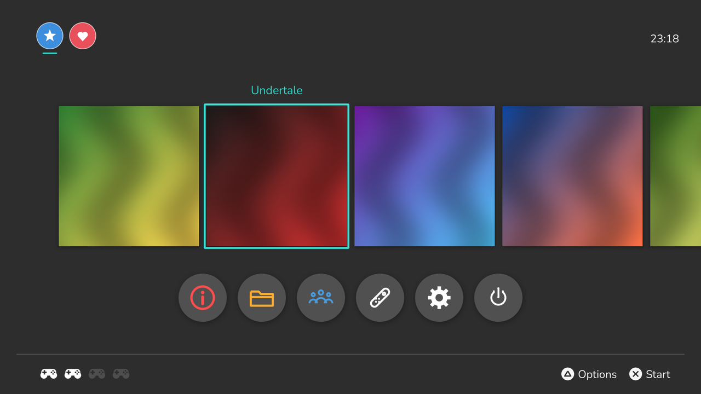

  

<h1 align="center">Eden4</h1>

  An unofficial PlayStation 4 port of the <a href="https://eden-emu.dev">Eden</a> Nintendo Switch emulator, 
  with a native, Switch-style HOME menu.

  
  
  

> [!IMPORTANT]
> Eden4 is experimental. Few games have been tried, most run well below full speed, and some
> crash. It needs a **jailbroken PS4** that can install fake PKGs, plus **your own** Switch keys,
> firmware and games, dumped from **your own** console. None of these are included or provided.
>
> Eden4 is not affiliated with or endorsed by the Eden team, Nintendo or Sony. All credit for
> the emulator itself belongs to the Eden project and the projects it builds on: see [CREDITS.md](CREDITS.md).

## What it is

Eden emulates the Nintendo Switch: its ARM64 CPU through the Dynarmic JIT, its GPU through Vulkan.
Eden4 builds Eden for the PS4's x86-64 Jaguar CPU, runs its Vulkan renderer on the PS4's GPU
through Mesa's RADV driver, and adds everything a console app needs: memory management for the PS4's
fixed memory pools, controllers, audio, a HOME menu, packaging and crash diagnostics.

Tested on a PS4 Pro (firmware 13.02, base PS4 mode)

## Install

1. Download `Eden4-01.00.pkg` from the [Releases](../../releases) page and install it with your
   usual PKG installer.
2. Copy your files to the console:
   - **Keys:** `/data/EdenPS4/keys/prod.keys` (and `title.keys` if you have one).
   - **Firmware:** the NCA files of your console's firmware in `/data/EdenPS4/nand/system/Contents/registered/`.
   - **Games:** NSP, XCI, NRO or NSO files in `/data/EdenPS4/games/`, on a USB drive, or in any
     folder you add under Game Files.
3. Open Eden4. Games appear on the HOME menu; their icons appear after their first start.

The app keeps its data in `/data/EdenPS4` (the name from its test builds). Logs are written there too:
`eden.log`, `crash.log`, `hang.log`, `xmb-trace.log`.

## Controls

| On the HOME menu | |
|---|---|
| Cross / Circle | Select / Back |
| Triangle | Game info, rename a user |
| Square | Remove a user or folder |
| Options | Sort All Software, edit a user's icon, rescan Game Files |
| L1 | Shift on the on-screen keyboard |
| Left stick or d-pad | Move |

In a game, the PS4 controller acts as a Switch Pro Controller (Cross = A, Circle = B, Triangle = X,
Square = Y, L1/R1 = L/R, L2/R2 = ZL/ZR, Options = +, touchpad click = −).
**L3 + R3 + Options** on any controller closes the game and returns to HOME.

## Features

**Emulation on the PS4**
- Eden's Switch emulation running natively on the PS4 as an installable app (fake PKG).
- Dynarmic ARM64 → x86-64 JIT tuned for the PS4's Jaguar CPU:
  - code cache protection switched in small windows, not the whole 64 MiB per compiled block
    (much faster start-up);
  - inline two-level page table walk, with a "direct" table of host-minus-guest offsets;
  - an IR pass that reuses one page lookup for several accesses to the same page;
  - register allocator improvements (R13 allocatable, cheaper register moves).
- 4 GiB of Switch memory in the PS4's direct memory, with a software page table.
- Vulkan rendering through Mesa RADV on the PS4 GPU (GNM winsys), with frame flips queued behind the
  GPU's work.
- Docked (up to 1080p) and Handheld (720p) console modes; 720p or 1080p video output.
- Game audio through the PS4's AudioOut.
- Optional build variant that also uses the PS4's seventh CPU core.

**Memory management for the PS4**
- A C heap (dlmalloc) that grows in 32 MiB steps from system flexible, flexible and direct memory,
  keeping a reserve for the GPU.
- The GPU page table is backed only where it is used (saves 128 MiB).
- Texture and buffer cache garbage collection sized from the real free GPU memory (~480 MiB), not the
  3 GiB the driver reports.
- Upload staging buffers capped and recycled; when GPU memory runs low or an allocation fails, the app
  waits for the GPU, frees idle buffers and retries instead of crashing.

**Controllers**
- Up to 4 controllers, one per signed-in PS4 user, as Switch players 1-4.
- Players join and leave during a game (sign in or out on another controller).
- Switch controller type per player (Pro Controller, Dual Joy-Cons, Left or Right Joy-Con).
- Change Order (swap players) and a live Test Controllers screen.

**HOME menu**, written in C++ and drawn by the CPU (runs only between games, so it costs games nothing):
- Switch-style HOME: users, clock, the 12 most recently played games, All Software, round shortcut buttons,
  connected controllers and button hints.
- All Software grid with sorting by title or file name, and a game info panel.
- Game icons and titles read from the game files (cached; saved when a game first starts).
- PS4-style loading screen built from the game's icon, shown until the game draws its first frame.
- Game sources: internal storage, USB drives (`/mnt/usb0`-`/mnt/usb7`, top folder and one folder down)
  and any folders you add; each can be turned on or off.
- Users: choose who plays, add, rename and remove users with an on-screen keyboard, icon editor
  (symbol and colour), or a photo from Eden's avatar folder.
- System Settings: users, display, controllers, Basic Black / Basic White themes, menu sounds,
  advanced emulation switches, system information, copy logs to USB.
- Synthesised menu sounds, launch animation, About and Power screens.

**Diagnostics**
- `crash.log` with registers and code addresses (alternate signal stack, so stack overflows are
  reported too), `hang.log` from a watchdog when the app or the game stops, and `xmb-trace.log`.
- Status lines every 10 s in `eden.log`: fps, emulation speed, frame time, memory.
- Optional sampling profiler (where the CPU time goes).
- Host tools: a JIT test harness that runs the real Dynarmic against AArch64 test programs on a PC,
  and a HOME menu preview that renders every screen to PNG.

## Documentation

- [Building](docs/BUILDING.md) - toolchain, Mesa, the package, the custom icon.
- [Known issues](docs/KNOWN_ISSUES.md) - possible bugs and limits.
- [Roadmap](docs/ROADMAP.md) - future work.
- [Architecture](docs/ARCHITECTURE.md) - how the port works, for contributors.
- [Changelog](docs/CHANGELOG.md) - from the first test build to 1.0.
- [Credits](CREDITS.md) - the projects and people this builds on.

## Custom icon

Put a square PNG or JPEG at [`branding/icon0.png`](branding) (and optionally a 1920x1080
`branding/pic1.png` for the PS4 home screen background), then build. See [branding/README.md](branding/README.md).

## License

Eden4 is free software under the [GNU General Public License v3.0 or later](LICENSE), like Eden.
The PS4 runtime in [`runtime/`](runtime) comes from DolphinPS4 (GPL-2.0-or-later), the Mesa GNM winsys
is MIT, and the Nunito font is under the SIL Open Font License; see [LICENSES/](LICENSES) and
[CREDITS.md](CREDITS.md).
